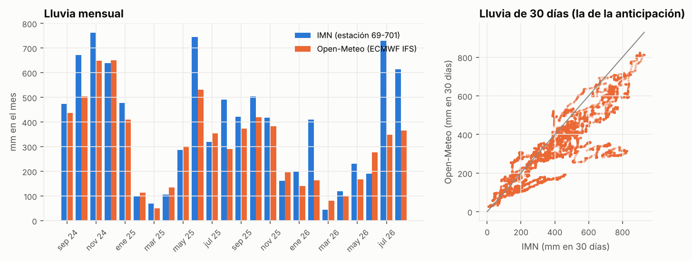

# Segunda fuente de lluvia (RNF-009)

Generado por `herramientas/fuente_lluvia.py`; no editar a mano (la lectura va en `fuente-lluvia-lectura.md`, que se agrega al final).

## Concordancia con la estación del IMN

Periodo del dataset (sep 2024 – ago 2026). Hora lluviosa: ≥ 1 mm; día lluvioso: ≥ 10 mm. POD: de las horas (días) lluviosas en el IMN, cuántas también lo son en Open-Meteo; FAR: de las que Open-Meteo marca, cuántas no lo fueron en el IMN.

| Serie | Total / IMN | r horaria | r diaria | r 24 h | r 30 días | POD hora | FAR hora | POD día | FAR día |
|---|---|---|---|---|---|---|---|---|---|
| Open-Meteo best_match | 0.69 | 0.15 | 0.40 | 0.42 | 0.83 | 31 % | 68 % | 58 % | 36 % |
| ECMWF IFS **(elegida)** | 0.81 | 0.22 | 0.49 | 0.51 | 0.89 | 33 % | 71 % | 68 % | 37 % |
| GFS | 0.59 | 0.13 | 0.36 | 0.35 | 0.75 | 24 % | 74 % | 41 % | 43 % |
| ICON | 0.36 | 0.19 | 0.33 | 0.36 | 0.76 | 16 % | 71 % | 27 % | 41 % |
| GEM | 1.39 | 0.14 | 0.39 | 0.41 | 0.76 | 52 % | 76 % | 80 % | 51 % |
| promedio de 4 modelos | 0.79 | 0.23 | 0.49 | 0.51 | 0.87 | 36 % | 68 % | 68 % | 41 % |

Lluvia total en el periodo: IMN 9176 mm, ECMWF IFS 7444 mm.



## Los modelos en el periodo de prueba (may – ago 2026)

Entrenados con entrenamiento + validación; lluvia de Open-Meteo: ECMWF IFS. Punto de operación: umbral / horas de confirmación; el guardado en `modelos/`, salvo en los dos casos que lo eligen otra vez en los 5 pliegues con la regla de los notebooks (compárense entre sí).

### Detector de eventos

| Caso | Eventos | Detectados | Alarmas | Falsas | Falsas/semana | Precisión | Sensibilidad | F1 | Punto |
|---|---|---|---|---|---|---|---|---|---|
| IMN (como hoy) | 25 | 18 | 40 | 0 | 0.00 | 100 % | 72 % | 84 % | 0.7 / 3 h |
| cambio en vivo (entrenados con IMN) | 25 | 18 | 39 | 0 | 0.00 | 100 % | 72 % | 84 % | 0.7 / 3 h |
| IMN, punto elegido otra vez | 25 | 18 | 40 | 0 | 0.00 | 100 % | 72 % | 84 % | 0.7 / 3 h |
| reentrenados con Open-Meteo | 25 | 18 | 46 | 3 | 0.22 | 93 % | 72 % | 81 % | 0.7 / 2 h |

Con la lluvia de Open-Meteo, la probabilidad del modelo entrenado con el IMN cambia en promedio 0.014 (percentil 99: 0.115).

### Anticipación a 24 h

| Caso | Eventos | Detectados | Alarmas | Falsas | Falsas/semana | Precisión | Sensibilidad | F1 | Punto |
|---|---|---|---|---|---|---|---|---|---|
| IMN (como hoy) | 27 | 10 | 11 | 2 | 0.30 | 82 % | 37 % | 51 % | tipo 1: 0.5 / 3 h; tipo 2: 0.3 / 3 h; tipo 3: 0.5 / 1 h; tipo 4: 0.2 / 2 h; tipo 5: 0.6 / 2 h |
| cambio en vivo (entrenados con IMN) | 27 | 3 | 3 | 0 | 0.00 | 100 % | 11 % | 20 % | tipo 1: 0.5 / 3 h; tipo 2: 0.3 / 3 h; tipo 3: 0.5 / 1 h; tipo 4: 0.2 / 2 h; tipo 5: 0.6 / 2 h |
| IMN, punto elegido otra vez | 27 | 9 | 14 | 4 | 0.61 | 71 % | 33 % | 45 % | tipo 1: 0.5 / 1 h; tipo 2: 0.3 / 2 h; tipo 3: 0.5 / 1 h; tipo 4: 0.3 / 3 h; tipo 5: 0.5 / 3 h |
| reentrenados con Open-Meteo | 27 | 7 | 10 | 3 | 0.46 | 70 % | 26 % | 38 % | tipo 1: 0.5 / 3 h; tipo 2: 0.4 / 1 h; tipo 3: 0.5 / 2 h; tipo 4: 0.4 / 1 h; tipo 5: 0.5 / 3 h |

Con la lluvia de Open-Meteo, la probabilidad del modelo entrenado con el IMN cambia en promedio 0.032 (percentil 99: 0.297).

### Fugas

| Caso | Eventos | Detectados | Alarmas | Falsas | Falsas/semana | Precisión | Sensibilidad | F1 | Punto |
|---|---|---|---|---|---|---|---|---|---|
| IMN (como hoy) | 9 | 4 | 6 | 0 | 0.00 | 100 % | 44 % | 62 % | 0.6 / 2 h |
| cambio en vivo (entrenados con IMN) | 9 | 4 | 6 | 0 | 0.00 | 100 % | 44 % | 62 % | 0.6 / 2 h |
| IMN, punto elegido otra vez | 9 | 7 | 14 | 4 | 0.23 | 71 % | 78 % | 74 % | 0.3 / 1 h |
| reentrenados con Open-Meteo | 9 | 7 | 10 | 1 | 0.06 | 90 % | 78 % | 83 % | 0.3 / 1 h |

Con la lluvia de Open-Meteo, la probabilidad del modelo entrenado con el IMN cambia en promedio 0.003 (percentil 99: 0.032).

Duración: 20.9 min.

## Lectura

**Por qué hace falta otra fuente.** Los sensores de la red no miden lluvia. La del dataset es la de
la estación 69-701 del IMN, que el simulador mete en las lecturas para poder entrenar; con la API de
datos definitiva no va a venir. El servicio de monitoreo la consigue de una fuente elegida con
`FUENTE_LLUVIA` (adaptadores en `Monitoreo_calidad_agua/backend/monitoreo/fuentes_lluvia.py`), y la
que se puede consultar en vivo para La Lucha es Open-Meteo.

**Concordancia.** Hora por hora, Open-Meteo casi no coincide con la estación (r ≈ 0,15–0,25): la
lluvia de la zona es convectiva y muy local, y una cuadrícula de 9 a 25 km no acierta la hora
exacta de un aguacero en un punto. La lluvia acumulada sí coincide: r ≈ 0,9 a 30 días. El mejor
modelo meteorológico es ECMWF IFS (r 0,89 a 30 días, 19 % menos lluvia que la estación), seguido
del promedio de los cuatro; ICON y GFS se quedan cortos y GEM se pasa. Es la serie que usa el
adaptador por defecto (`LLUVIA_MODELOS=ecmwf_ifs025`). El faltante no es parejo: en julio y agosto
de 2026, justo el periodo de prueba, Open-Meteo vio cerca de la mitad de la lluvia de la estación.

**Qué pasa con los modelos.** Los cuatro casos se calculan con el mismo procedimiento (entrenamiento
+ validación, prueba may–ago 2026), así que se comparan entre sí; pueden diferir un poco de los
notebooks, que entrenan y eligen el punto a su manera.

- **Detector y fugas no dependen de la fuente.** Si se cambia la lluvia en vivo sin reentrenar, su
  probabilidad cambia en promedio 0,014 y 0,003 y detectan lo mismo (18/25 y 4/9, sin falsas
  alarmas). Reentrenados con Open-Meteo quedan igual o mejor que con el IMN con la misma regla del
  punto de operación: detector F1 81 % contra 84 %; fugas 7/9 con 1 falsa contra 7/9 con 4 falsas
  (con 9 fugas en la prueba, la diferencia es de pocos casos).
- **La anticipación sí depende.** Usa la lluvia de 30 días, y con la de Open-Meteo, que es menor, el
  modelo entrenado con el IMN "ve" meses más secos de lo que fueron: cambiar la fuente sin reentrenar
  la hunde de 10 a 3 eventos anticipados de 27 (F1 51 % → 20 %). Reentrenada con Open-Meteo recupera
  buena parte: 7/27 con 3 falsos, F1 38 %, contra 9/27 con 4 falsos (F1 46 %) del IMN con la misma
  regla. Quedan unos 8 puntos de F1 de diferencia, el costo de usar una lluvia modelada en lugar de
  medida en el sitio.

**Decisión.** La arquitectura cumple RNF-009: la fuente se cambia con un adaptador y una variable
de entorno, y los modelos funcionan con la lluvia nueva sin tocar ningún módulo de modelado. Como en
operación la lluvia va a salir de Open-Meteo, **los modelos se reentrenaron con esa lluvia**
(`hiperparametros.yaml`, sección `datos`; `calidad_agua/fuentes_lluvia.py` la pone al cargar los
datos, y el reentrenamiento deja `modelos/fuente_lluvia.json` para que el servicio use la misma).

## Resultado del reentrenamiento con la lluvia de Open-Meteo

Los notebooks 06 a 10 con la lluvia de Open-Meteo (ECMWF), en el periodo de prueba (may–ago 2026),
comparados con los mismos notebooks con la lluvia de la estación del IMN:

| Modelo | Con la lluvia del IMN | Con la lluvia de Open-Meteo |
|---|---|---|
| Pronóstico a 24 h (notebook 08), acierto en operación normal | cloro 88 %, turbidez 48 %, pH 79,5 % | cloro 88 %, turbidez 49 %, pH 79,6 % |
| Detector (notebook 07) | Random Forest: 15 de 16 eventos de calidad, 0 falsas alarmas, F1 78 % | HistGradientBoosting: 16 de 16 (y 1 fuga), 3 falsas alarmas, F1 78,5 % |
| Anticipación a 24 h (notebook 09) | bosque: 11 de 16 con causa, 0,9 avisos falsos por semana, F1 51 % | LSTM: 10 de 16 con causa, 1,2 por semana, F1 46 % |
| Fugas (notebook 10) | SVM: 6 de 9, 1 falsa alarma, F1 76 % | SVM: 6 de 9, 2 falsas alarmas, F1 72 % |

(F1 por evento contando todos los eventos de la prueba, también los que ese modelo no busca.) Con
la lluvia de Open-Meteo se repitió la validación cruzada temporal y la búsqueda de hiperparámetros
(RF-002.3/4): se adoptaron configuraciones nuevas para el detector y para los dos modelos de árboles
de la anticipación (`docs/modelos/validacion-cruzada.md`), y la columna de Open-Meteo es con ellas.

- **El pronóstico, el detector y las fugas quedan igual.** Con Open-Meteo la regla de elección del
  notebook 07 prefiere HistGradientBoosting al bosque (más eventos detectados y menos falsas
  alarmas en la validación por bloques); en la prueba quedan empatados (F1 78,5 % y 78 %).
- **La anticipación pierde**, sobre todo en las contaminaciones por lluvia y baja presión (3 de 5
  contra 4 de 5) y en las fugas que crecen: en el simulador las causa la lluvia que cae en el sitio,
  que Open-Meteo solo aproxima. La regla del notebook 09 elige ahora la LSTM entre los cuatro
  modelos; con la primera versión reentrenada (HistGradientBoosting con la configuración anterior)
  los avisos falsos pasaban el tope de la regla en la prueba (2,7 por semana) y con la búsqueda de
  hiperparámetros bajaron a 1,2. Sigue siendo el modelo más débil (F1 de 46 % contra 51 % con la
  lluvia de la estación). Sus avisos son amarillos; las alarmas las dan el detector y el de fugas.
- **Lo que más ayudaría es lluvia medida en La Lucha.** Un pluviómetro que mande sus datos junto
  con las lecturas (`FUENTE_LLUVIA=lecturas`) daría lluvia como la de la estación, con la que la
  anticipación rinde más; también subiría el techo de la turbidez del pronóstico (notebook 06:
  72 % con Open-Meteo contra 87–91 % con la estación).

## Evidencia de que no se tocaron los módulos de modelado

Corresponde al commit de la prueba de concepto (antes del reentrenamiento, que va en un commit
aparte). En `Modelo_calidad_agua`, `git status` después de esta prueba solo muestra archivos nuevos y el
README; `calidad_agua/` (preprocesamiento, variables, detector, anticipación, fugas, validación)
no cambió:

```
$ git status --short
 M README.md
?? clima/lluvia_open_meteo_historica.csv
?? docs/modelos/fuente-lluvia-lectura.md
?? docs/modelos/fuente-lluvia.json
?? docs/modelos/fuente-lluvia.md
?? figuras/fuente_lluvia.png
?? herramientas/fuente_lluvia.py
?? pruebas/test_fuente_lluvia.py
$ git diff --stat -- calidad_agua/
(sin cambios)
```

En `Monitoreo_calidad_agua`, el motor (`motor.py`) y la carga de los modelos (`modelos.py`) no
cambiaron. Los adaptadores son un archivo nuevo de la capa de ingesta (`fuentes_lluvia.py`); el
servicio solo se tocó una vez, para envolver al cliente de la API de datos con la fuente elegida y
mostrar su estado en `/health` (10 líneas):

```
$ git diff --stat
 .env.ejemplo                  |  2 ++
 README.md                     | 21 +++++++++++++++++++++
 backend/monitoreo/config.py   |  4 ++++
 backend/monitoreo/servicio.py | 10 ++++++++--
$ git status --short backend/monitoreo/motor.py backend/monitoreo/modelos.py
(sin cambios)
```

De aquí en adelante, una fuente más (otra API, una estación propia) es solo una clase nueva
registrada en `FUENTES`. La prueba `test_una_fuente_nueva_es_solo_una_clase`
(`backend/pruebas/test_fuentes_lluvia.py`) lo comprueba: agrega un "pluviómetro" sin tocar nada
más, y el motor recibe su lluvia en cada lectura.

**En el reentrenamiento** (commit aparte) la lluvia de Open-Meteo entra por la capa de ingesta:
`carga.py` llama a un módulo nuevo, `calidad_agua/fuentes_lluvia.py`, y la fuente se elige en
`hiperparametros.yaml` (sección `datos`). Los módulos de modelado tampoco cambiaron por la lluvia; los
únicos cambios en ellos vienen de que con la lluvia nueva ganó otro modelo: `detector.modelo` pasó a
HistGradientBoosting en `hiperparametros.yaml`, `validacion.py` usa ahora el modelo que tenga cada
detector y anticipación (antes suponía el bosque) con su propia grilla de búsqueda, y omite la
anticipación cuando el notebook 09 elige la LSTM (para la que no está hecha la búsqueda), y el
comentario inicial de `detector.py` ya no dice cuál gana. Los hiperparámetros nuevos que salieron de
la búsqueda con esta lluvia (detector y modelos de árboles de la anticipación) solo cambian
`hiperparametros.yaml`. Al quedar la LSTM en la anticipación apareció un error que antes no se veía:
`anticipacion.secuencias` fallaba con menos horas que el largo de la ventana (el servicio al
arrancar); se corrigió y tiene su prueba.
