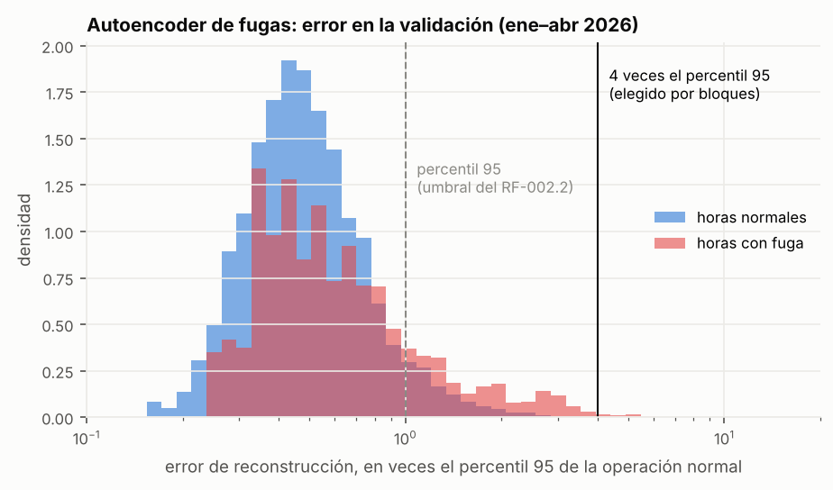

# Umbral del Autoencoder de fugas (RF-002.2)

El RF-002.2 pide fijar el umbral del Autoencoder en el **percentil 95 del error de reconstrucción
calculado sobre la operación normal (clase 0)** y documentarlo con su justificación estadística.
Este documento dice cómo se calcula, cuánto vale, qué tan bien separa las fugas y por qué en la
comparación se usa además un múltiplo de ese umbral.

Los números salen de `python herramientas/umbral_autoencoder.py`, que escribe
`docs/modelos/umbral-autoencoder.json` y `figuras/umbral_autoencoder.png`. El script usa los mismos
datos, horas normales y regresión que el notebook 10, con la lluvia de Open-Meteo (ECMWF).

## Cómo se calcula

1. **Entrada.** Las 123 variables del modelo de fugas (`fugas.tabla`). Son los residuos de caudal y
   presión contra lo esperado en operación normal: una regresión multivariable por señal y la línea
   base de la misma hora de la semana anterior (notebook 10, sección 1).
2. **Horas normales.** Las 9 426 horas del entrenamiento (sep 2024 – dic 2025) sin fuga y lejos de
   una. Se quitan la fuga pequeña que crece antes de la rotura y las 12 h después de la reparación
   (notebook 10, primera celda).
3. **Red.** Autoencoder denso (TensorFlow/Keras, `fugas.construir_autoencoder`). El codificador
   tiene capas de 32, 16 y 6 neuronas y el decodificador es su espejo. Se entrena con Adam (tasa
   0,001), lotes de 256 y hasta 60 épocas, con parada temprana (paciencia 5) sobre el 10 % de las
   horas y semilla 0. Las variables se estandarizan con las mismas horas normales.
4. **Error de una hora.** El error cuadrático medio entre la hora estandarizada y su reconstrucción.
5. **Umbral.** El percentil 95 de ese error en las horas normales del entrenamiento
   (`fugas.Autoencoder.fit`, `percentil: 95` en `hiperparametros.yaml`).
6. **Puntaje.** El modelo da error / umbral, así que 1 es el percentil 95.

## Valor del umbral

| | Error de reconstrucción |
|---|---|
| Mediana (percentil 50) | 0,269 |
| Percentil 75 | 0,360 |
| Percentil 90 | 0,480 |
| **Percentil 95 (umbral)** | **0,586** |
| Percentil 99 | 0,966 |
| Percentil 99,9 | 1,588 |
| Media | 0,307 |

**Reproducible:** entrenado dos veces con la misma semilla, el umbral sale idéntico (0,58598 las
dos veces, diferencia relativa 0). Con otros datos de entrenamiento o con otra versión de
TensorFlow puede cambiar. Por eso se guarda con el modelo y se vuelve a calcular en cada
reentrenamiento.

## Justificación estadística

El percentil 95 es un umbral **no paramétrico**. No supone que el error tenga una distribución
conocida, lo cual importa porque es claramente asimétrico (la media, 0,31, es mayor que la
mediana, 0,27, y la cola llega a más de 5 veces la mediana). Por construcción, en la operación
normal del entrenamiento el 5 % de las horas quedan sobre el umbral (5,01 % medido): es la tasa de
falsa alarma por hora que se acepta a cambio de no fijar el umbral mirando las fugas. Así, el
modelo sigue sin usar etiquetas, que es la razón para tener un Autoencoder.

Lo que pasa fuera del entrenamiento:

| Horas | Entrenamiento | Validación (ene – abr 2026) | Prueba (may – ago 2026) |
|---|---|---|---|
| Normales sobre el percentil 95 | 5,0 % de 9 426 | 15,1 % de 2 002 | 2,3 % de 2 479 |
| Con fuga sobre el percentil 95 | 38,6 % de 946 | 40,9 % de 318 | 45,4 % de 207 |
| Normales sobre 4 veces el percentil 95 | 0,0 % | 0,05 % | 0,0 % |
| Con fuga sobre 4 veces el percentil 95 | 6,1 % | 2,5 % | 8,2 % |

Las horas con fuga sí tienen más error (mediana de 0,81 veces el umbral contra 0,57 en la
validación), pero las dos distribuciones se superponen mucho. Ese es el problema del percentil 95
usado directamente como alarma:

- **Demasiadas falsas alarmas.** En la operación normal pasa del umbral más o menos 1 hora de cada
  20. Eso son varias alarmas por semana: en la validación por bloques del notebook 10, con el
  percentil 95 y sin confirmación, el Autoencoder detecta 39 de 48 fugas (81 %), pero con 4,2
  falsas alarmas por semana (7,6 en el peor bloque) y una precisión de 14 %.
- **Varía con la época.** En la validación, la época seca de ene – abr 2026, el 15 % de las horas
  normales pasan del umbral, tres veces lo esperado. El consumo y el bombeo cambian con la época y
  el Autoencoder no lo había visto igual en el entrenamiento.

## Umbral de operación del Autoencoder en la comparación

Para comparar el Autoencoder con los otros dos modelos en igualdad de condiciones, el notebook 10 le
aplica la misma regla de elección que a todos, fijada antes de ver los resultados. El umbral se
expresa en veces el percentil 95 (1; 1,5; 2; 3; 4; 6 y 8) y se combina con 1 a 3 horas de
confirmación. Se queda el que detecta más fugas con a lo sumo 1 falsa alarma por semana en cada
bloque de la validación por bloques. El elegido es **4 veces el percentil 95 con 3 horas de
confirmación**:

| Autoencoder | Validación por bloques (48 fugas) | Prueba (9 fugas) |
|---|---|---|
| Percentil 95, 1 h | 39 detectadas, 4,2 falsas por semana, precisión 14 %, F1 24 % | — (no cumple la regla) |
| 4 × percentil 95, 3 h (elegido) | 8 detectadas, 0,09 falsas por semana, precisión 53 %, F1 25 % | 1 detectada, 0 falsas, precisión 100 %, F1 20 % |

Con un umbral bajo hay demasiadas falsas alarmas. Con uno alto, el Autoencoder solo ve las fugas
más grandes. Por eso **la SVM es el modelo elegido para el servicio** (6 de 9 fugas en la prueba,
F1 72 %; `docs/modelos/comparacion-fugas.md`). El Autoencoder queda documentado como la opción sin
etiquetas, útil si la ASADA no llegara a tener registros de fugas para entrenar un modelo
supervisado.

## Dónde está en el código

| Qué | Dónde |
|---|---|
| Red, entrenamiento, umbral y puntaje | `calidad_agua/fugas.py`: `construir_autoencoder`, `Autoencoder` |
| Hiperparámetros, percentil y múltiplos del umbral probados | `calidad_agua/hiperparametros.yaml`: `fugas.autoencoder`, `fugas.eleccion.umbrales_autoencoder` |
| Comparación y elección | `notebooks/10_fugas.ipynb`, secciones 2 y 3; corridas `10 · Autoencoder` en MLflow (experimento `fugas`) |
| Estos números | `herramientas/umbral_autoencoder.py` → `docs/modelos/umbral-autoencoder.json` |
