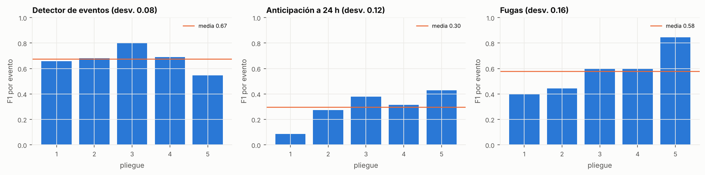
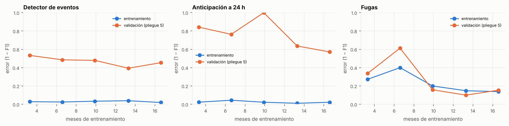
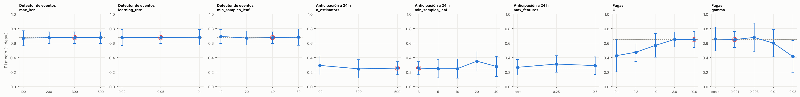

# Validación cruzada y búsqueda de hiperparámetros (RF-002.3 y RF-002.4)

> Generado por `python herramientas/validacion_cruzada.py` el 12/11/2026 18:48 (71 min de cálculo) · commit `9f10ce72` (con cambios sin commit) · datos sha256 `a0209416ebea`. No editar a mano: se vuelve a generar.

## Cómo se valida

**Time Series Split con k = 5** sobre las horas de entrenamiento y validación (sep 2024 – abr 2026). Cada pliegue entrena solo con el pasado (ventana creciente) y deja 24 h de separación antes del pliegue, para que las ventanas de las variables y la etiqueta de la anticipación (que mira 24 h adelante) no crucen. Lo que se ajusta con datos (valores típicos de cada sensor, regresión de la operación normal de las fugas) se recalcula en cada pliegue con su propio entrenamiento. El periodo de prueba (may–ago 2026) no se usa.

| Pliegue | Entrena | Valida | Meses de entrenamiento |
|---|---|---|---|
| 1 | 01/09/2024 – 10/12/2024 | 11/12/2024 – 22/03/2025 | 3.3 |
| 2 | 01/09/2024 – 21/03/2025 | 22/03/2025 – 01/07/2025 | 6.6 |
| 3 | 01/09/2024 – 30/06/2025 | 01/07/2025 – 10/10/2025 | 9.9 |
| 4 | 01/09/2024 – 09/10/2025 | 10/10/2025 – 19/01/2026 | 13.3 |
| 5 | 01/09/2024 – 18/01/2026 | 19/01/2026 – 01/05/2026 | 16.6 |

**Métrica: F1 por evento**, la de los notebooks. Precisión = alarmas (o avisos) que coinciden con un evento / alarmas; sensibilidad = eventos detectados (o anticipados) / eventos. El F1 depende del umbral y la confirmación: el del **modelo final** es el que usa el servicio; en la sensibilidad y la búsqueda cada configuración elige el suyo con la regla de los notebooks (el que más eventos detecta sin pasar del tope de falsas alarmas por semana en ningún pliegue), para comparar todas con las mismas reglas.

## Resumen

| Modelo | F1 por pliegue (media ± desv.) | Desv. ≤ 0.10 | F1 del modelo final (regla) | F1 de la mejor búsqueda | Mejora (puntos) | Decisión (RF-002.4) |
|---|---|---|---|---|---|---|
| Detector de eventos | 0.67 ± 0.08 | sí | 0.67 | 0.71 | +3.1 | se adopta la mejor configuración |
| Anticipación a 24 h | 0.30 ± 0.12 | no | 0.25 | 0.36 | +10.2 | se adopta la mejor configuración |
| Fugas | 0.58 ± 0.16 | no | 0.65 | 0.65 | +0.0 | el modelo final ya era óptimo |

Criterios: RF-002.3 pide una desviación del F1 entre pliegues ≤ 0.10; RF-002.4, que la búsqueda mejore el F1 en al menos 2 puntos o que se documente que el modelo ya era óptimo. Los hiperparámetros del modelo final están en `calidad_agua/hiperparametros.yaml`.

## Detector de eventos

Hiperparámetros del modelo final: `{"max_iter": "300", "learning_rate": "0.05", "max_leaf_nodes": "31", "min_samples_leaf": "40", "l2_regularization": "1.0", "class_weight": "balanced", "early_stopping": "True", "validation_fraction": "0.1", "random_state": "0"}`; umbral y confirmación: `(0.95, 2)`. Experimento de MLflow: `detector_eventos`.

### F1 por pliegue (modelo final)

| Pliegue | Eventos | Detectados | Alarmas | Falsas | Falsas/semana | Precisión | Sensibilidad | F1 |
|---|---|---|---|---|---|---|---|---|
| 1 | 20 | 12 | 29 | 8 | 0.71 | 72% | 60% | 0.66 |
| 2 | 20 | 11 | 27 | 3 | 0.26 | 89% | 55% | 0.68 |
| 3 | 24 | 16 | 27 | 0 | 0.00 | 100% | 67% | 0.80 |
| 4 | 18 | 10 | 21 | 2 | 0.17 | 90% | 56% | 0.69 |
| 5 | 23 | 10 | 15 | 4 | 0.35 | 73% | 43% | 0.55 |

Media 0.67, desviación estándar 0.08.

### Curva de aprendizaje

Último pliegue; se entrena con la parte más reciente del pasado.

| Meses | Desde | Eventos (entr.) | Error entrenamiento | Eventos (valid.) | Error validación |
|---|---|---|---|---|---|
| 3.3 | 2025-10-09 | 18 | 0.03 | 23 | 0.53 |
| 6.6 | 2025-06-30 | 41 | 0.03 | 23 | 0.49 |
| 9.9 | 2025-03-21 | 61 | 0.03 | 23 | 0.48 |
| 13.3 | 2024-12-11 | 80 | 0.04 | 23 | 0.39 |
| 16.6 | 2024-09-01 | 103 | 0.02 | 23 | 0.45 |

### Sensibilidad a los hiperparámetros

Un hiperparámetro a la vez; los demás, como en el modelo final.

| Hiperparámetro | Valor | F1 medio | Desv. | Detectados | De | Falsas/semana | Umbral elegido |
|---|---|---|---|---|---|---|---|
| max_iter | 100 | 0.67 | 0.10 | 59 | 105 | 0.37 | (0.9, 3) |
| max_iter | 200 | 0.67 | 0.08 | 59 | 105 | 0.30 | (0.95, 2) |
| max_iter | 300 (final) | 0.67 | 0.08 | 59 | 105 | 0.30 | (0.95, 2) |
| max_iter | 500 | 0.67 | 0.08 | 59 | 105 | 0.30 | (0.95, 2) |
| learning_rate | 0.02 | 0.68 | 0.11 | 61 | 105 | 0.38 | (0.9, 3) |
| learning_rate | 0.05 (final) | 0.67 | 0.08 | 59 | 105 | 0.30 | (0.95, 2) |
| learning_rate | 0.1 | 0.68 | 0.11 | 61 | 105 | 0.35 | (0.9, 3) |
| min_samples_leaf | 10 | 0.69 | 0.10 | 62 | 105 | 0.37 | (0.95, 2) |
| min_samples_leaf | 20 | 0.67 | 0.09 | 59 | 105 | 0.33 | (0.95, 2) |
| min_samples_leaf | 40 (final) | 0.67 | 0.08 | 59 | 105 | 0.30 | (0.95, 2) |
| min_samples_leaf | 80 | 0.68 | 0.11 | 60 | 105 | 0.30 | (0.9, 3) |

### Búsqueda al azar (10 configuraciones y el modelo final)

| Configuración | max_iter | learning_rate | max_leaf_nodes | min_samples_leaf | l2_regularization | F1 medio | Desv. | Detectados | De | Falsas/semana | Segundos |
|---|---|---|---|---|---|---|---|---|---|---|---|
| #9 | 150 | 0.05 | 63 | 80 | 3.0 | 0.71 | 0.12 | 63 | 105 | 0.25 | 110 |
| #3 | 500 | 0.03 | 15 | 10 | 0.0 | 0.70 | 0.11 | 63 | 105 | 0.33 | 142 |
| #8 | 300 | 0.1 | 63 | 20 | 1.0 | 0.69 | 0.10 | 63 | 105 | 0.38 | 84 |
| #6 | 500 | 0.1 | 15 | 20 | 0.0 | 0.69 | 0.11 | 60 | 105 | 0.25 | 86 |
| #5 | 300 | 0.1 | 15 | 20 | 0.0 | 0.69 | 0.11 | 60 | 105 | 0.25 | 85 |
| #2 | 300 | 0.03 | 15 | 20 | 0.0 | 0.68 | 0.10 | 59 | 105 | 0.25 | 129 |
| #1 | 150 | 0.03 | 31 | 20 | 0.0 | 0.68 | 0.09 | 61 | 105 | 0.33 | 106 |
| #10 | 300 | 0.05 | 31 | 10 | 3.0 | 0.68 | 0.09 | 60 | 105 | 0.31 | 117 |
| modelo final | — | — | — | — | — | 0.67 | 0.08 | 59 | 105 | 0.30 | 5 |
| #7 | 300 | 0.05 | 31 | 20 | 1.0 | 0.67 | 0.09 | 59 | 105 | 0.33 | 104 |
| #4 | 300 | 0.05 | 63 | 10 | 0.0 | 0.65 | 0.11 | 57 | 105 | 0.35 | 97 |

Mejor: #9 (F1 0.71); modelo final con la misma regla: 0.67 → diferencia +3.1 puntos.

## Anticipación a 24 h

Hiperparámetros del modelo final: `{"n_estimators": "500", "min_samples_leaf": "3", "max_features": "0.33", "max_depth": "None", "class_weight": "balanced_subsample", "n_jobs": "-1", "random_state": "0"}`; umbral y confirmación: `{1: (0.5, 3), 2: (0.3, 3), 3: (0.4, 2), 4: (0.2, 3), 5: (0.6, 2)}`. Experimento de MLflow: `anticipacion_eventos`.

### F1 por pliegue (modelo final)

| Pliegue | Eventos | Detectados | Alarmas | Falsas | Falsas/semana | Precisión | Sensibilidad | F1 |
|---|---|---|---|---|---|---|---|---|
| 1 | 22 | 1 | 1 | 0 | 0.00 | 100% | 5% | 0.09 |
| 2 | 22 | 7 | 25 | 19 | 3.37 | 24% | 32% | 0.27 |
| 3 | 24 | 10 | 23 | 15 | 2.89 | 35% | 42% | 0.38 |
| 4 | 22 | 6 | 16 | 10 | 1.60 | 38% | 27% | 0.32 |
| 5 | 20 | 9 | 22 | 13 | 1.76 | 41% | 45% | 0.43 |

Media 0.30, desviación estándar 0.12.

### Curva de aprendizaje

Último pliegue; se entrena con la parte más reciente del pasado.

| Meses | Desde | Eventos (entr.) | Error entrenamiento | Eventos (valid.) | Error validación |
|---|---|---|---|---|---|
| 3.3 | 2025-10-09 | 21 | 0.02 | 20 | 0.84 |
| 6.6 | 2025-06-30 | 45 | 0.04 | 20 | 0.76 |
| 9.9 | 2025-03-21 | 67 | 0.02 | 20 | 1.00 |
| 13.3 | 2024-12-11 | 89 | 0.01 | 20 | 0.64 |
| 16.6 | 2024-09-01 | 112 | 0.02 | 20 | 0.57 |

### Sensibilidad a los hiperparámetros

Un hiperparámetro a la vez; los demás, como en el modelo final.

| Hiperparámetro | Valor | F1 medio | Desv. | Detectados | De | Falsas/semana | Umbral elegido |
|---|---|---|---|---|---|---|---|
| n_estimators | 100 | 0.29 | 0.13 | 27 | 110 | 1.35 | {1: (0.5, 3), 2: (0.3, 3), 3: (0.5, 3), 4: (0.4, 1), 5: (0.5, 3)} |
| n_estimators | 300 | 0.24 | 0.13 | 22 | 110 | 1.16 | {1: (0.5, 3), 2: (0.4, 1), 3: (0.5, 2), 4: (0.4, 1), 5: (0.7, 2)} |
| n_estimators | 500 (final) | 0.25 | 0.09 | 23 | 110 | 1.43 | {1: (0.5, 3), 2: (0.4, 1), 3: (0.5, 2), 4: (0.4, 1), 5: (0.5, 3)} |
| min_samples_leaf | 3 (final) | 0.25 | 0.09 | 23 | 110 | 1.43 | {1: (0.5, 3), 2: (0.4, 1), 3: (0.5, 2), 4: (0.4, 1), 5: (0.5, 3)} |
| min_samples_leaf | 5 | 0.25 | 0.13 | 24 | 110 | 1.24 | {1: (0.5, 3), 2: (0.4, 3), 3: (0.5, 3), 4: (0.4, 1), 5: (0.7, 1)} |
| min_samples_leaf | 10 | 0.25 | 0.13 | 25 | 110 | 1.51 | {1: (0.6, 2), 2: (0.5, 1), 3: (0.6, 1), 4: (0.3, 3), 5: (0.7, 2)} |
| min_samples_leaf | 20 | 0.35 | 0.14 | 34 | 110 | 1.42 | {1: (0.6, 2), 2: (0.5, 3), 3: (0.7, 1), 4: (0.4, 2), 5: (0.7, 3)} |
| min_samples_leaf | 40 | 0.28 | 0.14 | 25 | 110 | 1.19 | {1: (0.7, 2), 2: (0.7, 1), 3: (0.8, 1), 4: (0.5, 2), 5: (0.8, 1)} |
| max_features | sqrt | 0.27 | 0.11 | 28 | 110 | 1.48 | {1: (0.4, 2), 2: (0.2, 3), 3: (0.4, 2), 4: (0.2, 3), 5: (0.5, 2)} |
| max_features | 0.25 | 0.31 | 0.11 | 31 | 110 | 1.58 | {1: (0.5, 1), 2: (0.2, 3), 3: (0.5, 1), 4: (0.3, 1), 5: (0.5, 3)} |
| max_features | 0.5 | 0.29 | 0.12 | 25 | 110 | 1.14 | {1: (0.6, 1), 2: (0.4, 3), 3: (0.9, 2), 4: (0.4, 1), 5: (0.6, 3)} |

### Búsqueda al azar (10 configuraciones y el modelo final)

| Configuración | n_estimators | min_samples_leaf | max_features | max_depth | class_weight | F1 medio | Desv. | Detectados | De | Falsas/semana | Segundos |
|---|---|---|---|---|---|---|---|---|---|---|---|
| #7 | 300 | 40 | 0.33 | 20 | balanced | 0.36 | 0.14 | 34 | 110 | 1.32 | 59 |
| #2 | 300 | 20 | sqrt | None | balanced | 0.32 | 0.12 | 30 | 110 | 1.20 | 33 |
| #1 | 300 | 5 | sqrt | None | balanced | 0.30 | 0.18 | 28 | 110 | 0.79 | 36 |
| #3 | 500 | 5 | 0.2 | None | balanced | 0.27 | 0.16 | 26 | 110 | 1.22 | 79 |
| #9 | 100 | 20 | 0.33 | 10 | balanced_subsample | 0.25 | 0.15 | 21 | 110 | 0.89 | 30 |
| modelo final | — | — | — | — | — | 0.25 | 0.09 | 23 | 110 | 1.43 | 4 |
| #10 | 100 | 40 | 0.33 | 10 | balanced_subsample | 0.25 | 0.15 | 24 | 110 | 1.37 | 29 |
| #4 | 300 | 3 | sqrt | 10 | balanced | 0.24 | 0.17 | 24 | 110 | 1.12 | 33 |
| #8 | 300 | 3 | 0.33 | None | balanced_subsample | 0.24 | 0.13 | 22 | 110 | 1.16 | 93 |
| #5 | 300 | 20 | 0.2 | 10 | balanced | 0.22 | 0.10 | 18 | 110 | 1.18 | 44 |
| #6 | 100 | 10 | 0.33 | 10 | balanced | 0.22 | 0.13 | 17 | 110 | 0.81 | 25 |

Mejor: #7 (F1 0.36); modelo final con la misma regla: 0.25 → diferencia +10.2 puntos.

## Fugas

Hiperparámetros del modelo final: `{"C": "10.0", "kernel": "rbf", "gamma": "0.001", "class_weight": "None", "random_state": "0"}`; umbral y confirmación: `(0.5, 2)`. Experimento de MLflow: `fugas`.

### F1 por pliegue (modelo final)

| Pliegue | Eventos | Detectados | Alarmas | Falsas | Falsas/semana | Precisión | Sensibilidad | F1 |
|---|---|---|---|---|---|---|---|---|
| 1 | 11 | 3 | 4 | 1 | 0.07 | 75% | 27% | 0.40 |
| 2 | 7 | 2 | 4 | 0 | 0.00 | 100% | 29% | 0.44 |
| 3 | 7 | 3 | 6 | 0 | 0.00 | 100% | 43% | 0.60 |
| 4 | 7 | 3 | 5 | 0 | 0.00 | 100% | 43% | 0.60 |
| 5 | 11 | 9 | 16 | 2 | 0.14 | 88% | 82% | 0.85 |

Media 0.58, desviación estándar 0.16.

### Curva de aprendizaje

Último pliegue; se entrena con la parte más reciente del pasado.

| Meses | Desde | Eventos (entr.) | Error entrenamiento | Eventos (valid.) | Error validación |
|---|---|---|---|---|---|
| 3.3 | 2025-10-09 | 7 | 0.27 | 11 | 0.34 |
| 6.6 | 2025-06-30 | 14 | 0.40 | 11 | 0.61 |
| 9.9 | 2025-03-21 | 21 | 0.20 | 11 | 0.16 |
| 13.3 | 2024-12-11 | 31 | 0.15 | 11 | 0.10 |
| 16.6 | 2024-09-01 | 37 | 0.14 | 11 | 0.15 |

### Sensibilidad a los hiperparámetros

Un hiperparámetro a la vez; los demás, como en el modelo final.

| Hiperparámetro | Valor | F1 medio | Desv. | Detectados | De | Falsas/semana | Umbral elegido |
|---|---|---|---|---|---|---|---|
| C | 0.1 | 0.43 | 0.22 | 17 | 43 | 0.24 | (0.7, 3) |
| C | 0.3 | 0.47 | 0.13 | 17 | 43 | 0.22 | (0.7, 3) |
| C | 1.0 | 0.57 | 0.16 | 22 | 43 | 0.21 | (0.4, 3) |
| C | 3.0 | 0.65 | 0.10 | 28 | 43 | 0.35 | (0.3, 2) |
| C | 10.0 (final) | 0.65 | 0.11 | 31 | 43 | 0.37 | (0.3, 1) |
| gamma | scale | 0.66 | 0.16 | 33 | 43 | 0.53 | (0.3, 2) |
| gamma | 0.001 (final) | 0.65 | 0.11 | 31 | 43 | 0.37 | (0.3, 1) |
| gamma | 0.003 | 0.68 | 0.20 | 32 | 43 | 0.39 | (0.3, 2) |
| gamma | 0.01 | 0.60 | 0.19 | 25 | 43 | 0.29 | (0.3, 3) |
| gamma | 0.03 | 0.41 | 0.22 | 18 | 43 | 0.33 | (0.3, 3) |

### Búsqueda al azar (10 configuraciones y el modelo final)

| Configuración | C | gamma | class_weight | F1 medio | Desv. | Detectados | De | Falsas/semana | Segundos |
|---|---|---|---|---|---|---|---|---|---|
| modelo final | — | — | — | 0.65 | 0.11 | 31 | 43 | 0.37 | 0 |
| #10 | 10.0 | 0.0003 | None | 0.61 | 0.19 | 24 | 43 | 0.19 | 11 |
| #9 | 10.0 | 0.01 | balanced | 0.61 | 0.13 | 29 | 43 | 0.50 | 18 |
| #8 | 3.0 | scale | balanced | 0.60 | 0.14 | 30 | 43 | 0.57 | 21 |
| #3 | 0.03 | scale | None | 0.60 | 0.13 | 24 | 43 | 0.29 | 15 |
| #7 | 1.0 | 0.01 | balanced | 0.56 | 0.15 | 24 | 43 | 0.35 | 27 |
| #6 | 0.3 | scale | balanced | 0.52 | 0.21 | 22 | 43 | 0.33 | 37 |
| #4 | 0.1 | 0.001 | balanced | 0.45 | 0.23 | 16 | 43 | 0.18 | 46 |
| #2 | 0.03 | 0.003 | balanced | 0.42 | 0.22 | 14 | 43 | 0.12 | 50 |
| #1 | 0.03 | 0.0003 | balanced | 0.40 | 0.13 | 18 | 43 | 0.40 | 61 |
| #5 | 0.1 | 0.003 | None | 0.39 | 0.23 | 15 | 43 | 0.17 | 14 |

Mejor: modelo final (F1 0.65); modelo final con la misma regla: 0.65 → diferencia +0.0 puntos.

## Curvas de aprendizaje y sensibilidad

## Lectura de los resultados

Esta sección se escribe a mano (`docs/modelos/validacion-cruzada-lectura.md`) y el generador la agrega
al reporte. Corresponde a las corridas del 12/11/2026, con la lluvia de Open-Meteo (RNF-009,
`docs/modelos/fuente-lluvia.md`), con la que se reentrenaron todos los modelos.

**Cómo leer las diferencias.** Con 5 pliegues y una desviación de 0,08 a 0,16 entre ellos, el error
estándar de un F1 medio es de 0,04 a 0,07: diferencias de pocos puntos entre configuraciones están
dentro del ruido. Además, quedarse con la mejor de 10 configuraciones favorece a la que tuvo suerte
en los pliegues. Por eso cada cambio que sugirió la búsqueda se miró también en la prueba
(may–ago 2026), que la búsqueda no vio, antes de adoptarlo.

**Las tablas son de los modelos antes de adoptar la búsqueda.** Las secciones *F1 por pliegue
(modelo final)*, la curva de aprendizaje y la sensibilidad de cada modelo se calcularon con la
configuración que tenía el modelo cuando se corrió la validación; las configuraciones adoptadas son
las mejores de cada tabla de búsqueda, y ya están en `calidad_agua/hiperparametros.yaml`.

**Detector de eventos (HistGradientBoosting).** Con la lluvia de Open-Meteo la regla del notebook 07
elige HistGradientBoosting en lugar del Random Forest, y la validación se hizo con él (grilla
`detector_arboles`). Es el más estable: F1 de 0,67 ± 0,08 entre pliegues (cumple la desviación
≤ 0,10). Es menor que en la prueba porque los primeros pliegues entrenan con pocos meses: la curva
de aprendizaje baja de un error de validación de 0,53 con 3 meses a 0,39–0,45 desde 13 meses. El
error de entrenamiento es casi cero, así que lo que limita es la variedad de eventos, no el tamaño
del modelo. La sensibilidad es plana (0,67–0,69 con cualquier valor de iteraciones, tasa de
aprendizaje o mínimo por hoja). La mejor configuración de la búsqueda (#9: 150 iteraciones, hasta 63
hojas, mínimo 80 por hoja, l2 de 3) gana **+3,1 puntos y se adoptó**. En la prueba detecta los mismos
eventos con menos falsas alarmas: con el procedimiento de esta validación, 16 de 25 con 2 falsas
alarmas contra 5 (F1 76 % contra 74 %); en el notebook 07, que elige además el umbral y la
confirmación por bloques, 17 de 25 con 3 falsas alarmas en 4 meses y F1 de 78,5 % (96 % en eventos
de calidad).

**Anticipación a 24 h.** Fue el modelo que más cambió:

1. Con el modelo que había al empezar (HistGradientBoosting por tipo) el F1 entre pliegues fue de
   0,31 ± 0,13, y la mejor configuración de la búsqueda (300 iteraciones, tasa 0,03, 7 hojas,
   mínimo 20 por hoja, sin l2) dio 0,37: **+5,7 puntos, se adoptó**. En la prueba anticipaba 11 de
   27 eventos con 0,61 avisos falsos por semana, contra 9 de 27 con 2,43.
2. Al reentrenar con esa configuración, la regla del notebook 09 eligió el **bosque aleatorio**, que
   todavía tenía la configuración de la búsqueda hecha con la lluvia del IMN. Se repitió la
   validación con el bosque (es la sección *Anticipación a 24 h* de este reporte): 0,30 ± 0,12 entre
   pliegues con su umbral, 0,25 con la regla, y la mejor configuración de la búsqueda (#7: 300
   árboles, mínimo 40 por hoja, profundidad 20, 33 % de las variables por corte, clases pesadas) dio
   0,36: **+10,2 puntos, se adoptó**. En la prueba, con el procedimiento de esta validación, anticipa
   13 de 27 eventos con 1,22 avisos falsos por semana (F1 57 %), contra 9 de 27 (48 %).
3. Con los dos modelos de árboles ya ajustados con la lluvia de Open-Meteo se corrió el notebook 09
   una última vez, decidido de antemano que lo que eligiera la regla quedaba como final (sin otra
   vuelta de búsqueda). La regla eligió la **LSTM**: 30 de 85 eventos con causa anticipados en los
   bloques, contra 28 de HistGradientBoosting y 26 del bosque. En la prueba anticipa 11 de 27 (10
   de 16 con causa) con 1,22 avisos falsos por semana: F1 de 46 %. La LSTM no entra en esta
   búsqueda (`validacion.py` la omite); sus hiperparámetros son los de la sección `anticipacion.lstm`.

La desviación entre pliegues no cumple ≤ 0,10 en ninguna variante (0,12–0,13): el primer pliegue
entrena con 3 meses y anticipa 1 evento de 22. La curva de aprendizaje todavía baja (error de 0,84
con 3 meses a 0,57 con 16): más historia ayudaría, porque cada tipo tiene pocos eventos. La
sensibilidad es ruidosa y los hiperparámetros interactúan: en el bosque, subir el mínimo por hoja
a 20 da 0,35 y a 40 baja a 0,28, mientras que la configuración #7 combina 40 con profundidad 20 y
clases pesadas. El F1 de este modelo tiene un techo bajo porque los eventos al azar (40 % de los de
la prueba) no tienen señal previa.

**Fugas (SVM).** La configuración que salió de la búsqueda con la lluvia del IMN (C = 10, gamma =
0,001, sin pesar las clases) sigue siendo la mejor con la de Open-Meteo: F1 de 0,65 con la regla, y
ninguna de las 10 configuraciones la supera, así que **el modelo final ya era óptimo**. Con el umbral
guardado da 0,58 ± 0,16 entre pliegues, que no cumple la desviación ≤ 0,10: los primeros pliegues
tienen pocas fugas para entrenar y detectan 2 o 3 de 7 a 11, mientras que el último detecta 9 de 11.
La curva de aprendizaje lo confirma (error de 0,34 a 0,61 con 3 a 7 meses y de 0,10 a 0,16 desde
10 meses). En la prueba detecta 6 de 9 fugas con 2 falsas alarmas (F1 72 %, notebook 10).

**Lo que queda para los requisitos.**

- RF-002.3: la validación cruzada temporal, las curvas de aprendizaje y la sensibilidad están en
  este reporte, que se genera solo y se puede repetir con Docker. La desviación ≤ 0,10 se cumple en
  el detector; en la anticipación (0,12) y en fugas (0,16) no, por los pocos eventos de los primeros
  pliegues.
- RF-002.4: en el detector y en los dos modelos de árboles de la anticipación la búsqueda mejoró el
  F1 en más de 2 puntos y la configuración nueva está en `hiperparametros.yaml`; en fugas se
  documenta que ya era óptimo. Cada configuración probada quedó en MLflow, en el experimento de su
  modelo, con sus hiperparámetros, F1 y duración. El modelo de anticipación que usa el servicio es
  la LSTM, que se eligió con la validación por bloques del notebook 09 entre los modelos ya ajustados.

## Cómo repetirlo

Con el entorno de este proyecto: `python herramientas/validacion_cruzada.py`. Con Docker, desde esta carpeta: `docker compose run --rm validacion` (ver README, **Docker**). Pliegues, grillas y semilla: `hiperparametros.yaml`, sección `validacion`.
